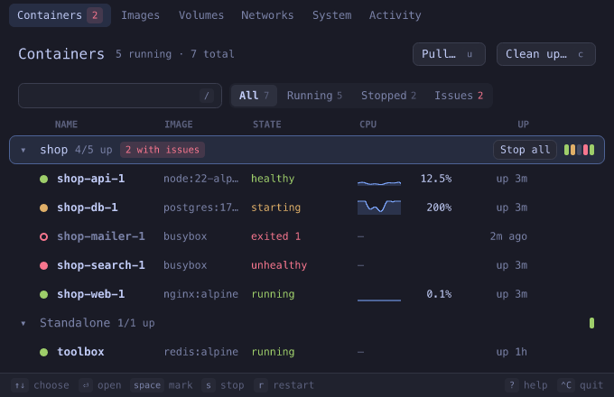

# dockerpen

Docker, in the terminal pane: containers, their logs and resource use, images, volumes,
networks and the disk they take, as a real interface — with the keyboard or the mouse, in
the colours and font of your terminal, on your machine or on a server over plain `ssh`.


dockerpen is a [pencere](https://github.com/bateri/pencere) program, written in Lua. Run it
in a terminal that hosts pencere views ([bateri](https://github.com/bateri/bateri)) and the
pane becomes the interface, the way `vim` takes the screen and gives it back; quit and the
shell is where it was. Run it anywhere else and it prints the containers.

The pictures here are drawn with the page kit's own engine, in the colours of one theme and
a stand-in font; bateri draws the same page in your terminal's font and theme.

## What it does

**Containers**, grouped by compose project, the ones that run first and the projects that do
not run folded away. Each row has its state in a word and a colour (running, healthy,
unhealthy, starting, paused, exited with its code), a CPU line, memory, and how long it has
been as it is. Filter by name, image or port; show all, running, stopped, or only the ones
with issues (unhealthy, restarting, or exited with a failure: a container that was merely
stopped is not an issue).

Start, stop, restart, pause, kill and remove one container, a whole project, or several
marked ones at once; what removes something asks first, in the page. A stop can be undone
from the toast that says it happened.

**The detail of a container**, beside the list or over it in a narrow pane:

- _Overview_: CPU, memory and network as the last readings, why it stopped (the exit code,
  the signal it means, out of memory), its health checks, ports, networks, mounts, command,
  restart policy and labels.
- _Logs_: live, with the program's own colours, stderr marked, search with `n`/`N`, follow
  that stops when you scroll up and tells you how many lines came since, timestamps, and a
  window of the log that is as cheap for a hundred thousand lines as for a hundred.
- _Environment_: with values that look secret hidden until you ask.
- _Processes_: what runs in it, looked at again while you look.
- _Inspect_: the engine's whole answer.

**A shell in the container, in the terminal.** Press `e`: the interface steps aside, the pane
is a `docker exec -it` shell in the container, and when you `exit` the interface comes back
where you left it. `F` does the same for `docker logs --follow`, for when you want the raw
stream.

**Images** with their size, age and the containers made from them, their layers one key
away; pull a new one or the latest of a tag, and remove what is unused or dangling.
**Volumes** with the space each takes and who mounts it. **Networks** with their subnets and
the containers on each. **System**: the disk Docker takes, what of it nothing uses, and a
clean-up that says what it will free before it frees it. **Activity**: what the engine
reported; a container that died, ran out of memory or turned unhealthy is also told as a
toast wherever you are.

|                                                           |                                                      |
| --------------------------------------------------------- | ---------------------------------------------------- |
|      |             |
|  |                                                      |

## The keyboard, and the mouse

Everything the mouse does, the keys do too, and the other way round: rows answer a click,
⌘- or ⇧-click marks, right-click opens the menu of the row. The status line says what the
keys do where you are, and `?` lists them all.

|                            |                                                                          |
| -------------------------- | ------------------------------------------------------------------------ |
| `1`–`6`                    | containers, images, volumes, networks, system, activity                  |
| `↑` `↓` / `j` `k`, `g` `G` | move, first, last                                                        |
| `⏎` `→` / `←`              | open, expand / back, collapse                                            |
| `space`, `a`, `A`          | mark (to act on many), mark all, none; a project row is all of its own  |
| `s` `r` `p`                | start or stop, restart, pause or resume                                  |
| `e`, `F`                   | a shell in the container, its logs as they come: in the terminal         |
| `l`, `i`, `[` `]`          | logs, inspect, previous and next tab                                     |
| `Tab`                      | the list or the detail                                                   |
| `K`, `d`                   | kill, remove (both ask first)                                            |
| `/`, `f`, `P`, `o`         | filter, next filter, group by compose project, sort                      |
| `y`, `.`                   | copy the id, the menu of the row                                         |
| `u`, `c`                   | pull an image, clean up                                                  |
| `⌃C`                       | quit                                                                     |

`⌃C` always reaches dockerpen, and the terminal's own shortcuts stay the terminal's. The
terminal has one text field to give a page, so the filter, the search of a log and the name
of an image to pull are all that field: what it says is what the list on show is filtered by.

## Run it

dockerpen is one file, with the interface inside it and nothing else to install but Docker.
Take the file for your system from the
[latest release](https://github.com/bateri/dockerpen/releases/latest) — macOS on Apple
silicon, or Linux on `arm64` or `x86_64` — check it against `SHA256SUMS`, and put it on your
`PATH` as `dockerpen`:

```sh
chmod +x dockerpen-0.3.0-aarch64-apple-darwin
mv dockerpen-0.3.0-aarch64-apple-darwin ~/.local/bin/dockerpen
```

To see the interface you need a terminal that hosts pencere views. bateri is the first, and
no release of it has them yet: until one does, build bateri from its `main` branch. In any
other terminal dockerpen prints the containers as text.

```sh
dockerpen                           # the interface
dockerpen web                       # open with a container chosen (name, service or id)
dockerpen --section images          # or on another part
dockerpen --text                    # the containers as text, whatever the terminal is
```

**It runs the `docker` command, and nothing else.** dockerpen does not talk to the engine's
socket: it starts `docker ps`, `docker stats`, `docker logs`, `docker events` and the rest,
and reads what they print. So it reaches the engine the way `docker` does for you — the
current Docker context, `DOCKER_HOST`, a rootless Docker, Docker Desktop, OrbStack, Colima,
Rancher Desktop, or Podman's `docker` — with nothing to set up, and it needs only that
`docker` is on the `PATH`. One `docker events` and one `docker stats` run while the screens
that need them are shown, and none while they are not: an idle dockerpen starts nothing.

**Over ssh.** Copy the file for the server's system to it and run it there, in a pane of a
terminal that hosts pencere: nothing listens on a port, the interface travels in the
terminal's own stream, and it runs on your machine in a sandbox that reaches nothing but its
program. Its files cross the stream once; after that the terminal keeps them.

**What it does not do.**

- It is not an MCP server any more: the Node program of dockerpen 0.2 was one, and `show_docker`
  and the tools a model could call (`list_containers`, `container_logs`, `disk_usage`) are not in
  this one. `dockerpen --text` prints the containers for whatever wants them as text.
- It does not open a published port in the browser, and has no command palette: a page of the
  kit can ask its terminal to pop up a menu, to copy and to give it a text field, and not to open
  a link or to hold two fields.
- Lines of a log are one line each, cut at the edge of the pane: `⇧→` reads them further to the
  right.

## How it works

- `src/program/` is dockerpen's program, in Lua, for the runner of the `pencere` command. The
  rule of its directories is one sentence: **`api/` knows the page; `docker/`, `state/` and
  `terminal/` do not.**
  - `docker/` runs the docker command and reads what it prints (`parse.lua` is what is read
    of sizes, ports, labels and dates);
  - `state/` is what the program holds: the containers, kept up to date from the engine's
    events, the readings of the last two minutes of each, what the engine reported, the jobs
    (a pull, a clean-up), and where the page was, so that a page that comes back from a shell
    finds it all;
  - `terminal/` is the command line, the pane handed to a shell or to a log and taken back, and
    the containers printed where the terminal shows no views;
  - `api/` is what the page asks and listens to: its calls, its topics and the shape of their
    params. `app.lua` wires them to `serve` and does nothing else.
- `src/view/page.lua` is the interface, a page of the pencere kit: boxes and lines of text that
  the terminal lays out and draws in its own font and theme, every colour a role of the theme.
  A page is one script, so it is one file, in parts under banners. A log is a window of rows:
  only the lines in view are made, however many there are.
- `src/assets/` are the icons.
- `make build` has `pencere build` pack all of it into the runner: `dist/dockerpen`, about 4 MB.

## Work on it

You need Node 22 (for the tests and the release tools only: dockerpen has no Node in it),
[StyLua](https://github.com/JohnnyMorganz/StyLua) (`cargo install stylua --locked --features luau`),
and a checkout of [pencere](https://github.com/bateri/pencere) beside this one, built there:

```sh
cargo build --release -p pencere-cli     # the `pencere` command, the runner of the program
cargo build -p pencere-fake-host         # the stand-in terminal the tests play dockerpen in
```

```sh
git clone https://github.com/bateri/dockerpen && cd dockerpen
make check          # formatting, the program built, the page's tests, and dist/dockerpen
                    # in a pane under pencere-fake-host with a stand-in docker
make fmt            # format the Lua
pencere dev         # in a pane of a terminal that hosts pencere: run it from its files,
                    # and again when one under src/ changes (print goes to .pencere/log)
```

`make` looks for the runner at `../pencere/target/release/pencere`, the stand-in terminal at
`../pencere/target/debug/pencere-fake-host` and the kit's page API at
`../pencere/kit/luau/prelude`; `PENCERE=`, `FAKE_HOST=` and `PRELUDE=` say where else.

What the tests are:

- `test/program.test.mjs` runs the built program in a pane under the stand-in terminal, with a
  **stand-in `docker`** first on the `PATH` (`test/fixtures/bin/docker`, which answers from the
  recorded output in `test/fixtures/` and logs what it was asked): what the page is told for each
  call and topic, a stream that comes and goes, a `docker` that is missing, one with no engine,
  one that fails. Nothing in them runs the machine's own Docker.
- `test/lua.test.mjs` runs `test/lua/` in the runner: what the program reads of docker's output,
  the feeds, and **the page against the kit's own page API** (the prelude of a pencere checkout:
  the Lua a terminal gives a page), with what the program tells it and the keys and clicks it
  is given. How a page looks is not tested, since nothing is laid out there; that is the
  terminal's.

No test is skipped: a runner, a stand-in or a program that is not there stops the run and says
which. `demo/compose.yaml` is a small shop to open dockerpen on:

```sh
docker compose -f demo/compose.yaml -p shop up -d
docker compose -f demo/compose.yaml -p shop down -v
```

How a version is released is in [RELEASING.md](RELEASING.md), and what each one changed in
[CHANGELOG.md](CHANGELOG.md).

## License

dockerpen is free software: you can redistribute it and/or modify it under the terms of the
[GNU General Public License](LICENSE) as published by the Free Software Foundation, either
version 3 of the License, or (at your option) any later version. It is distributed in the hope
that it will be useful, but WITHOUT ANY WARRANTY; see the license for details.
