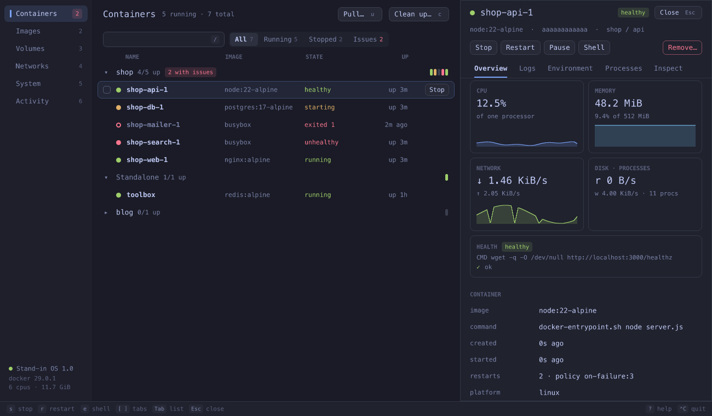
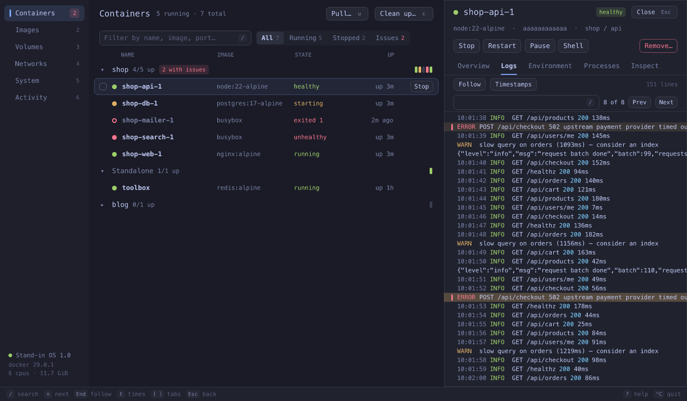
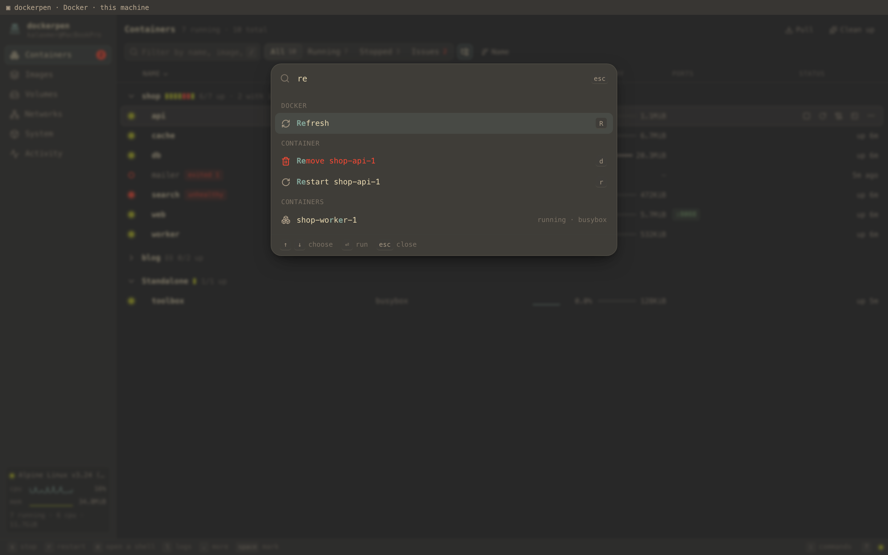
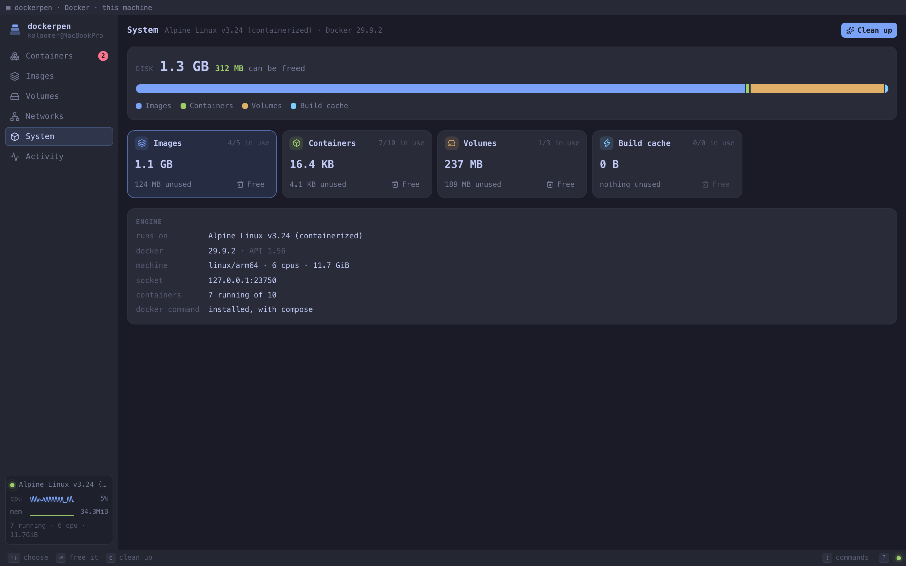
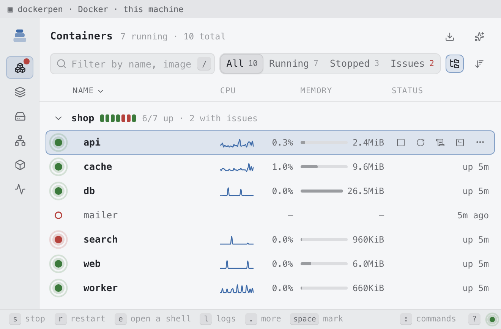

# dockerpen

Docker, in the terminal pane: containers, their logs and resource use, images, volumes,
networks and the disk they take, as a real interface — with the keyboard or the mouse, in
the colours and font of your terminal, on your machine or on a server over plain `ssh`.



dockerpen is a [pencere](https://github.com/bateri/pencere) program. Run it in a terminal
that hosts pencere views ([bateri](https://github.com/bateri/bateri)) and the pane becomes
the interface, the way `vim` takes the screen and gives it back; quit and the shell is where
it was. Run it anywhere else and it prints the containers. Give it to an MCP client and it is
an MCP server whose `show_docker` tool shows the same interface there.

## What it does

**Containers**, grouped by compose project, the ones that run first and the stopped projects
folded away. Each row has its state (a pulse while it runs, a spinner while it starts, stops or
restarts), health, a CPU sparkline, memory, published ports you can open in the browser, and
how long it has been as it is. Filter by name, image or port; show all, running, stopped, or
only the ones with issues (unhealthy, restarting, or exited with a failure — a container that
was merely stopped is not an issue).

Start, stop, restart, pause, kill and remove one container, a whole project, or several marked
ones at once. A stop can be undone from the toast that says it happened.

**The detail of a container**, beside the list or over it in a narrow pane:

- _Overview_ — CPU, memory and network over the last two minutes, in charts that scroll as the
  samples come; why it stopped (the exit code, the signal it means, out of memory), its health
  checks, ports, networks, mounts, command, restart policy and labels.
- _Logs_ — live, with the program's own colours, stderr marked, levels picked out, search with
  `n`/`N`, follow that pauses when you scroll up and tells you how many lines came since.
- _Environment_ — with values that look secret hidden until you ask.
- _Processes_ — what runs in it, refreshed while you look.
- _Inspect_ — the engine's whole answer.

**A shell in the container, in the terminal.** Press `e`: the interface steps aside, the pane
is a `docker exec -it` shell in the container, and when you `exit` the interface comes back
where you left it. `F` does the same for `docker logs --follow`, for when you want the raw
stream.

**Images** with their size, age and the containers made from them, their layers one key away;
pull a new one or the latest of a tag, and remove what is unused or dangling. **Volumes** with
the space each takes and who mounts it. **Networks** with their subnets and the containers on
each. **System**: the disk Docker takes, what of it nothing uses, and a clean-up that says
what it will free before it frees it. **Activity**: what the engine reported — a container that
died, ran out of memory or turned unhealthy shows up there, and as a toast wherever you are.

|                                                           |                                                         |
| --------------------------------------------------------- | ------------------------------------------------------- |
|      |                 |
|  |  |

## The keyboard, and the mouse

Everything the mouse does, the keys do too, and the other way round: rows answer clicks,
double-clicks, ⌘/⌃-click and shift-click to mark, and right-click for their menu; panels resize
by dragging. The status line says what the keys do where you are, and `?` lists them all.

|                            |                                                                              |
| -------------------------- | ---------------------------------------------------------------------------- |
| `:` or `⌃K`                | command palette: every command, container, image, volume and network by name |
| `1`–`6`                    | containers, images, volumes, networks, system, activity                      |
| `↑` `↓` / `j` `k`, `g` `G` | move, first, last                                                            |
| `⏎` `→` / `←`              | open, expand / back, collapse                                                |
| `space`, `a`, `A`          | mark (to act on many), mark all, none                                        |
| `s` `r` `p`                | start or stop, restart, pause or resume                                      |
| `e`, `F`                   | a shell in the container, its logs as they come — in the terminal            |
| `l`, `i`, `[` `]`          | logs, inspect, previous and next tab                                         |
| `o`, `y`                   | open the published port, copy the id                                         |
| `K`, `d`                   | kill, remove (both ask first)                                                |
| `/`, `f`, `P`              | filter, next filter, group by compose project                                |
| `.`                        | the menu of the chosen row                                                   |
| `⌃C`                       | quit                                                                         |

`⌃C` always reaches dockerpen, and the terminal's own shortcuts stay the terminal's.

## Run it

It needs Node 22 where it runs, and a Docker engine it can reach: `DOCKER_HOST`, the current
Docker context, or the socket of Docker, Docker Desktop, OrbStack, Colima, Rancher Desktop or
Podman. The shell and the log follower need the `docker` command as well.

To see the interface you need a terminal that hosts pencere views. bateri is the first, and no
release of it has them yet: until one does, build bateri from its `main` branch. In any other
terminal dockerpen prints the containers as text.

```sh
npm install -g dockerpen
dockerpen                           # or, without installing it: npx dockerpen
dockerpen web                       # open with a container chosen (name, service or id)
dockerpen --section images          # or on another part
```

**Over ssh.** Install it on the server and run it there, in a pane of a terminal that hosts
pencere: nothing listens on a port, the interface travels in the terminal's own stream, and it
runs on your machine in a sandbox that reaches nothing but its program. The first time, its
files cross the stream once; after that the terminal keeps them.

**In an MCP client.** Give it `npx -y dockerpen` as a stdio server (in Claude Code:
`claude mcp add dockerpen -- npx -y dockerpen`).
The model can list containers, read logs and look at the disk (`list_containers`,
`container_logs`, `disk_usage`) and show the interface (`show_docker`); whatever changes or
removes something is for the person, in the interface.

## How it works

- `src/server` is an ordinary MCP server. It talks to the Docker Engine API over its socket,
  with Node's `http` and nothing else; keeps two minutes of each running container's resource
  use; follows the engine's event stream; runs pulls and clean-ups as jobs the view follows,
  since a terminal gives up a view's request that takes more than a minute.
- `src/server/main.ts` is the one place that knows about the terminal: `serve` from
  `@pencere/sdk` opens the view in the pane. To hand the pane to a shell it closes the view
  with a `ViewControl`, runs `docker exec -it` with the terminal, and opens the view again; what
  the view was doing is kept by the program, so the new one starts where the old one was.
- `src/view` is the interface: React, [Motion](https://motion.dev) and
  [Lucide](https://lucide.dev), talking MCP Apps' messages to its host. Every colour is mixed
  from the variables the host sends, which a pencere terminal fills from its own theme. It polls
  its program once a second and asks only for what is on screen.

## Work on it

```sh
git clone https://github.com/bateri/dockerpen && cd dockerpen
npm install
make check          # types, build, formatting, and the server as an MCP client starts it
npm run harness     # http://localhost:5199 — the view in a stand-in host, with live Docker
npx vite build --watch & npm run dev   # in a pencere terminal: the view is shown again
                                       # each time its build changes
```

How a version is released is in [RELEASING.md](RELEASING.md), and what each one changed in
[CHANGELOG.md](CHANGELOG.md).

The harness plays the terminal in a browser: it frames the view with hot reload, sends it the
colours of a terminal theme (bateri's, Tokyo Night, Gruvbox, Solarized and more) and the size of
a pane (80×24 up), and passes its calls to the real server. `demo/compose.yaml` starts a small
shop to look at — a web front, an API that logs in colour, a busy worker, a database, a cache,
a search whose health check fails and a mailer that crashes:

```sh
docker compose -f demo/compose.yaml -p shop up -d
docker compose -f demo/compose.yaml -p shop down -v
```

## License

dockerpen is free software: you can redistribute it and/or modify it under the terms of the
[GNU General Public License](LICENSE) as published by the Free Software Foundation, either
version 3 of the License, or (at your option) any later version. It is distributed in the hope
that it will be useful, but WITHOUT ANY WARRANTY; see the license for details.
